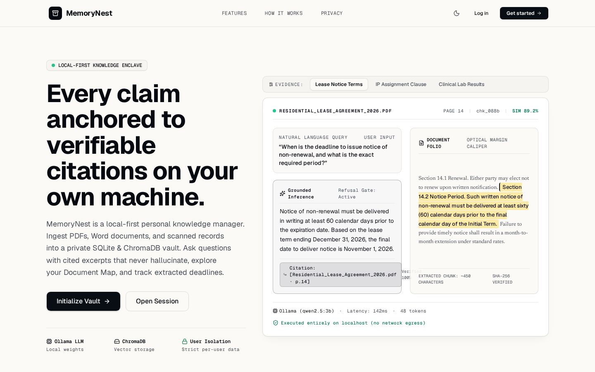
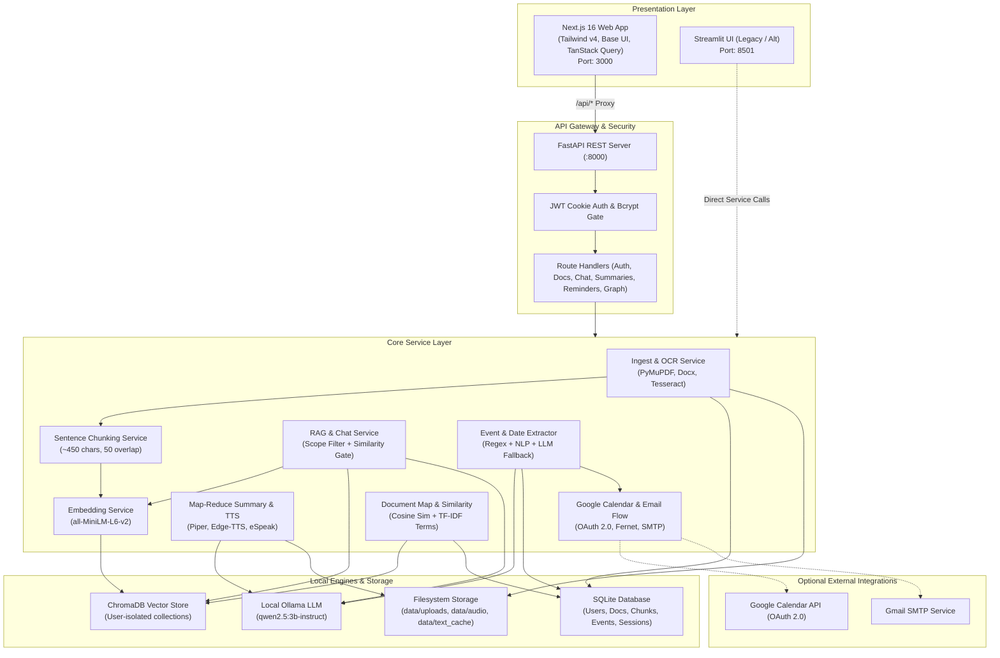
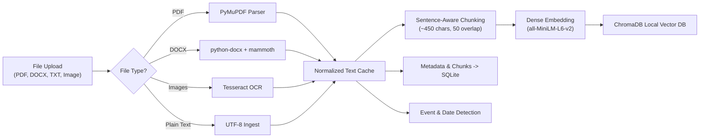
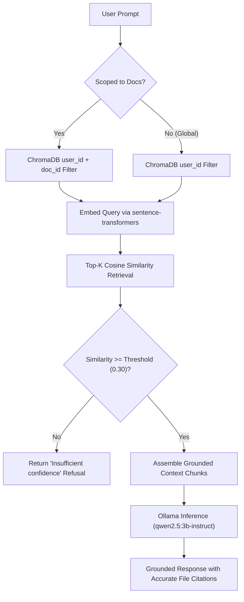
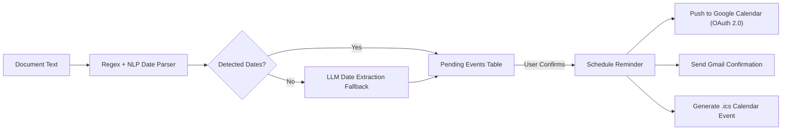
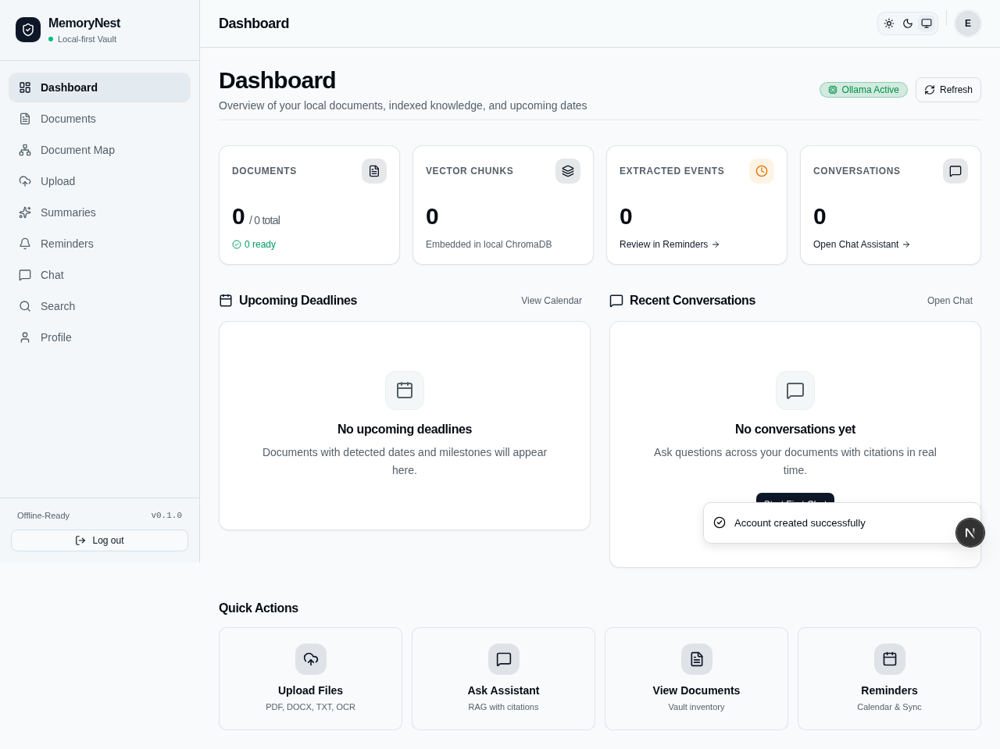
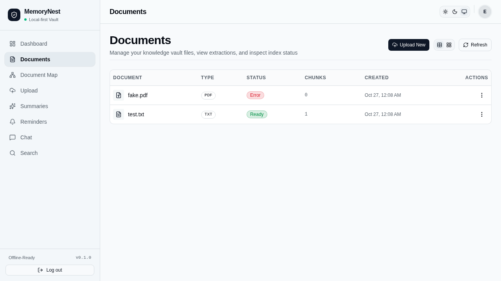
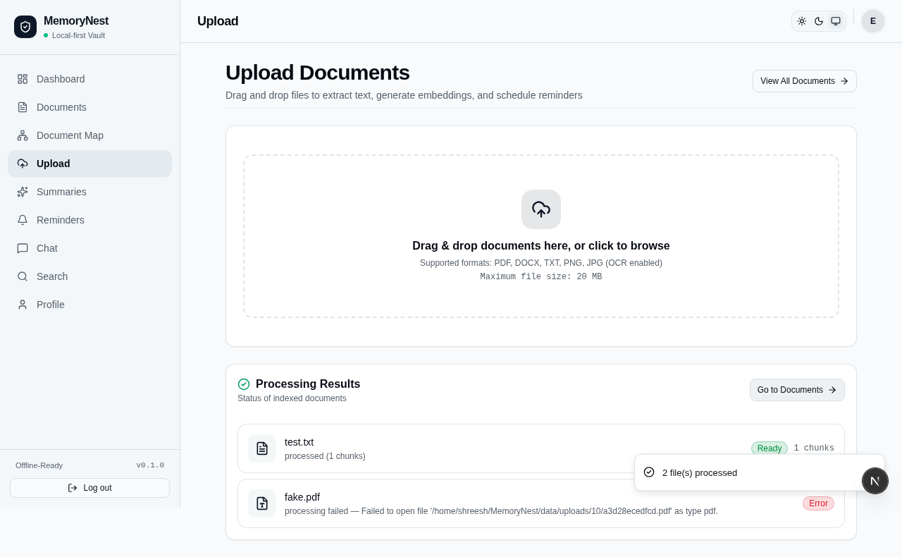
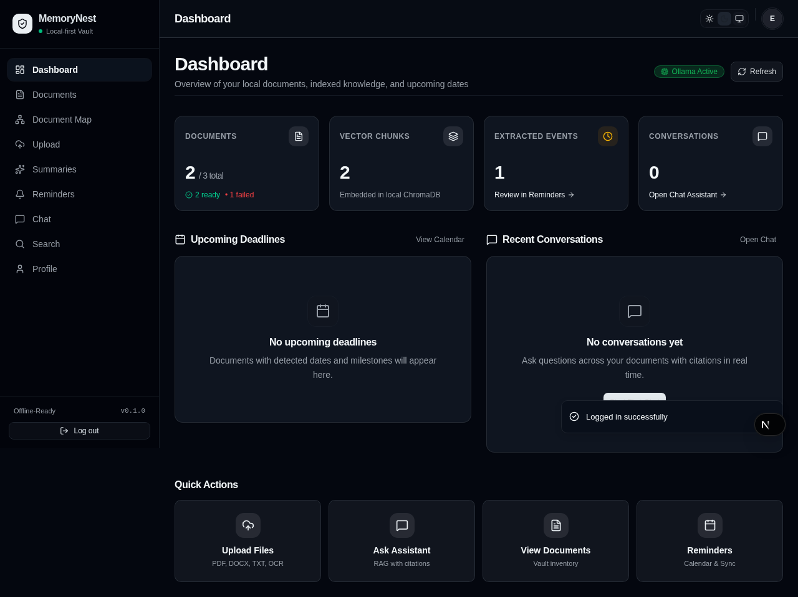

# 🪺 MemoryNest — Personal Knowledge Manager

<p align="center">
  <strong>A local-first, privacy-focused knowledge hub for intelligent document indexing, scoped RAG search, audio briefings, and calendar automation.</strong>
</p>

<p align="center">
  <a href="#-tech-stack"></a>
  <a href="#-tech-stack"></a>
  <a href="#-tech-stack"></a>
  <a href="#-tech-stack"></a>
  <a href="#-tech-stack"></a>
  <a href="#-testing--quality-assurance"></a>
  <a href="#-license"></a>
</p>

---



## 📖 Overview

**MemoryNest** is a local, privacy-first personal knowledge manager designed to ingest, index, and synthesize documents and images without sending sensitive data to cloud providers.

Upload **PDFs, DOCX files, raw TXT documents, and scanned images (via OCR)** — all processing, vector embedding, similarity ranking, and generative AI inference execute strictly on your own hardware. Ask precise questions with document-scoped **RAG**, listen to generated **TTS audio briefings**, explore topic relationships with an interactive **2D Force-Directed Document Map**, and automatically extract **deadlines and calendar events** that sync directly to **Google Calendar** or export as standard `.ics` files.

---

## 📑 Table of Contents

- [Overview](#-overview)
- [System Architecture](#-system-architecture)
- [Core Pipelines](#-core-pipelines)
  - [1. Ingestion & Indexing Pipeline](#1-ingestion--indexing-pipeline)
  - [2. Scoped RAG & Citations Pipeline](#2-scoped-rag--citations-pipeline)
  - [3. Event Extraction & Calendar Sync Flow](#3-event-extraction--calendar-sync-flow)
- [Key Features](#-key-features)
- [Visual Interface Showcase](#-visual-interface-showcase)
- [Tech Stack](#-tech-stack)
- [Quick Start](#-quick-start)
  - [Prerequisites & System Dependencies](#1-prerequisites--system-dependencies)
  - [Local LLM Setup (Ollama)](#2-local-llm-setup-ollama)
  - [Python Environment & Backend Setup](#3-python-environment--backend-setup)
  - [Web Frontend Setup](#4-web-frontend-setup)
  - [Running Everything](#5-running-everything)
- [Configuration & Environment Variables](#-configuration--environment-variables)
- [Google Calendar OAuth Setup](#-google-calendar-oauth-setup)
- [Voice & TTS Options](#-voice--tts-options)
- [REST API Reference](#-rest-api-reference)
- [Document Map Maintenance](#-document-map-maintenance)
- [Testing & Quality Assurance](#-testing--quality-assurance)
- [License](#-license)

---

## 🏛️ System Architecture

MemoryNest separates concerns into a reactive **Next.js 16 Web Frontend**, a high-performance **FastAPI API Gateway**, and a modular **Service Layer** backed by local-only storage engines:



---

## ⚡ Core Pipelines

### 1. Ingestion & Indexing Pipeline

Every uploaded file is safely validated, text-extracted, chunked with sentence boundaries preserved, and indexed into both a relational database and a local vector store.



### 2. Scoped RAG & Citations Pipeline

MemoryNest allows querying across your entire library or filtering retrieval to a selected subset of active documents.



### 3. Event Extraction & Calendar Sync Flow

Never miss a deadline or action item extracted from contracts, invoices, syllabi, or meeting notes.



---

## ✨ Key Features

| Feature | Description |
| :--- | :--- |
| 🛡️ **100% Local & Privacy-First** | All documents, vector embeddings, chunk databases, and LLM inference run strictly on your local device. No third-party data tracking or telemetry. |
| 🎯 **Scoped Document Chat** | Ask questions against your entire library or scope retrieval to specific files. Supports multi-turn conversation history with citation tracking. |
| 🗺️ **Document Map (Knowledge Graph)** | Interactive 2D force-directed graph powered by mean chunk cosine similarities with shared TF-IDF terms labeling the connections. |
| 📑 **Universal Ingestion & Dual Viewer** | Ingest PDFs, DOCX, TXT, and scanned image files. In-browser viewer supports original rendering (PDF iframe, sanitized DOCX HTML) and cached extracted text. |
| 🎙️ **Map-Reduce Summaries & TTS Audio** | Condenses massive documents into executive briefs. Automatically converts summaries into audio via **Piper**, **Edge-TTS**, or **eSpeak-ng**. |
| 📅 **Event Extraction & Google Calendar Sync** | Discovers dates and deadlines using pattern matching and LLM extraction. Syncs confirmed events directly to Google Calendar via OAuth 2.0 or exports `.ics`. |
| 🔍 **Semantic Vector Search** | Standalone vector similarity search with real-time relevance scoring and highlighted snippet previews. |
| 🌗 **Dark Mode & Archival Design** | Elegant "Evidence Chamber" aesthetic featuring Geist Sans, Geist Mono, Newsreader typography, Lenis smooth scrolling, and complete dark mode persistence. |

---

## 🖼️ Visual Interface Showcase

<div align="center">

### Modern Knowledge Dashboard
*Instant overview of your indexed document library, deadlines, and recent chats.*


---

### Ingestion & Documents Inventory
*Real-time processing status, file type badges, and dual-mode document viewer.*


---

### Drag-and-Drop File Upload Flow
*Client-side file validation, multi-file uploads, and automatic OCR ingestion.*


---

### Dark Mode & Archival Styling
*Thoughtfully crafted theme variables with reduced-motion compliance and high-contrast readability.*


</div>

---

## 🛠️ Tech Stack

### Web Frontend
- **Framework**: [Next.js 16](https://nextjs.org/) (App Router, Turbopack, React 19)
- **Styling**: [Tailwind CSS v4](https://tailwindcss.com/)
- **UI Components**: [Base UI](https://base-ui.com/), [shadcn/ui](https://ui.shadcn.com/) patterns, [Lucide React](https://lucide.dev/) icons, [Sonner](https://sonner.emilkowal.ski/)
- **Graph Visualization**: `react-force-graph-2d`
- **State & Data Fetching**: TanStack React Query v5
- **Alternative / Legacy UI**: [Streamlit](https://streamlit.io/) (Python)

### Backend API & Storage
- **API Framework**: [FastAPI](https://fastapi.tiangolo.com/) (RESTful, Pydantic v2, HTTP-only JWT cookies)
- **Relational DB**: SQLite 3 with schema migrations and cascade deletes
- **Vector Database**: [ChromaDB](https://www.trychroma.com/) (PersistentClient mode, isolated by user_id)

### AI, Machine Learning & Media
- **Local LLM**: [Ollama](https://ollama.ai/) with `qwen2.5:3b-instruct` (3B parameters, CPU & GPU compatible)
- **Embeddings**: `sentence-transformers/all-MiniLM-L6-v2` (fast 384-dimensional dense vectors)
- **OCR Engine**: [Tesseract OCR](https://github.com/tesseract-ocr/tesseract) via `pytesseract`
- **Document Extractors**: [PyMuPDF](https://pymupdf.readthedocs.io/) (PDF), [python-docx](https://python-docx.readthedocs.io/) & [mammoth](https://github.com/mwilliamson/python-mammoth) (DOCX)
- **Text-to-Speech (TTS)**: Piper TTS (neural offline), Edge-TTS (natural cloud voice), eSpeak-ng (lightweight offline fallback)

---

## 🚀 Quick Start

### 1. Prerequisites & System Dependencies

On Ubuntu/Debian Linux:

```bash
# Install core system packages for OCR, audio, and TTS
sudo apt-get update
sudo apt-get install -y tesseract-ocr espeak-ng ffmpeg python3-venv
```

### 2. Local LLM Setup (Ollama)

Install Ollama and pull the recommended lightweight instruct model:

```bash
# Install Ollama
curl -fsSL https://ollama.ai/install.sh | sh

# Pull the 3B model (runs smoothly even on CPU)
ollama pull qwen2.5:3b-instruct
```

### 3. Python Environment & Backend Setup

```bash
# Clone the repository
git clone https://github.com/Shreesh-o/MemoryNest.git
cd MemoryNest

# Create and activate Python virtual environment
python3 -m venv .venv
source .venv/bin/activate

# Install backend dependencies
pip install -r requirements.txt

# Create initial environment file
cp .env.example .env
```

### 4. Web Frontend Setup

```bash
# Navigate to web directory and install npm packages
cd web
npm install
cd ..
```

### 5. Running Everything

Use the unified development runner `scripts/dev.sh`. It performs automatic preflight checks, starts Ollama, spins up the FastAPI backend on port `8000`, and launches the Next.js frontend on port `3000`:

```bash
# Start all services with hot reload
bash scripts/dev.sh
```

| Service | Address |
| :--- | :--- |
| **Next.js Web Application** | [http://localhost:3000](http://localhost:3000) |
| **Interactive API Documentation (Swagger)** | [http://localhost:8000/docs](http://localhost:8000/docs) |
| **Streamlit UI (Alternative)** | [http://localhost:8501](http://localhost:8501) (`streamlit run app/main.py`) |

#### Runner Command Options:

```bash
bash scripts/dev.sh --stop      # Cleanly stop all running background services
bash scripts/dev.sh --prod      # Production build and launch
bash scripts/dev.sh --fresh     # Launch with an isolated, clean temporary database
bash scripts/dev.sh --force     # Start even if optional preflight checks warn
```

---

## ⚙️ Configuration & Environment Variables

Key configuration options in `.env`:

| Variable | Default Value | Description |
| :--- | :--- | :--- |
| `OLLAMA_HOST` | `http://localhost:11434` | Ollama daemon endpoint address |
| `OLLAMA_MODEL` | `qwen2.5:3b-instruct` | LLM model identifier in Ollama |
| `EMBEDDING_MODEL` | `all-MiniLM-L6-v2` | Sentence-transformers model name |
| `DB_PATH` | `data/memorynest.db` | SQLite database file location |
| `CHROMA_DIR` | `data/chroma` | ChromaDB vector store directory |
| `UPLOAD_DIR` | `data/uploads` | Uploaded document storage path |
| `AUDIO_DIR` | `data/audio` | Generated TTS audio directory |
| `RAG_TOP_K` | `5` | Number of context chunks retrieved per query |
| `RAG_MIN_SIMILARITY` | `0.30` | Minimum cosine similarity threshold for RAG answers |
| `CHUNK_SIZE` | `450` | Target chunk size in characters |
| `CHUNK_OVERLAP` | `50` | Overlap between sequential chunks |
| `LINK_MIN_SIMILARITY`| `0.45` | Cosine similarity threshold for Document Map visualization |
| `LINK_STORE_MIN_SIMILARITY`| `0.30` | Minimum similarity floor for persisted document relations |
| `LINK_MAX_PER_DOC` | `3` | Maximum number of outgoing edges per document node |
| `TTS_ENGINE` | `auto` | Engine strategy: `auto`, `piper`, `edge`, or `espeak` |
| `TTS_VOICE` | `en_US-lessac-medium` | Default voice identifier for TTS |
| `JWT_SECRET` | *(auto-generated)* | Key for signing HTTP-only session cookies |
| `JWT_EXPIRE_MINUTES` | `720` | Session lifetime (12 hours) |
| `GOOGLE_CLIENT_ID` | `""` | Google Cloud OAuth 2.0 Web Client ID |
| `GOOGLE_CLIENT_SECRET` | `""` | Google Cloud OAuth 2.0 Client Secret |
| `GOOGLE_REDIRECT_URI` | `http://localhost:8000/api/google/callback` | OAuth redirect callback URI |
| `TOKEN_ENCRYPTION_KEY` | `""` | Fernet key for encrypting stored Google refresh tokens |

---

## 📅 Google Calendar OAuth Setup

MemoryNest can automatically push confirmed reminders to your Google Calendar and remove them if cancelled.

### 1. Google Cloud Console
1. Navigate to the [Google Cloud Console](https://console.cloud.google.com/) and create a project (`MemoryNest`).
2. Go to **APIs & Services > Library** and enable the **Google Calendar API**.
3. Under **OAuth consent screen**:
   - Choose **External** for personal testing.
   - Add scopes: `https://www.googleapis.com/auth/calendar.events` and `https://www.googleapis.com/auth/userinfo.email`.
   - Add your Google account email under **Test Users**.
4. Under **Credentials**:
   - Create **OAuth client ID** > **Web application**.
   - Set **Authorized redirect URIs** to `http://localhost:8000/api/google/callback`.
   - Copy your **Client ID** and **Client Secret**.

### 2. Generate Fernet Token Encryption Key
```bash
python -c "from cryptography.fernet import Fernet; print(Fernet.generate_key().decode())"
```

### 3. Add to `.env`
```env
GOOGLE_CLIENT_ID=your-google-client-id.apps.googleusercontent.com
GOOGLE_CLIENT_SECRET=your-google-client-secret
GOOGLE_REDIRECT_URI=http://localhost:8000/api/google/callback
FRONTEND_URL=http://localhost:3000
TOKEN_ENCRYPTION_KEY=your-generated-fernet-key
```

### 4. Lifecycle & Behavior
- Click **Connect Google Calendar** on the **Reminders** page to authorize via Google OAuth 2.0.
- When you confirm an event, it is immediately synchronized to your primary Google Calendar.
- If an event is cancelled, it is automatically removed from Google Calendar.
- Fallback **Download .ics** remains available at all times.

---

## 🔊 Voice & TTS Options

MemoryNest features a multi-tier speech synthesis pipeline:

- **`auto` (Default)**: Dynamically checks available engines in order: `piper` (local neural) ➔ `edge-tts` (online neural) ➔ `espeak-ng` (local synthesized) ➔ `pyttsx3`.
- **`piper`**: Ultra-fast offline neural TTS using lightweight ONNX voice models.
- **`edge`**: High-fidelity natural neural speech (requires internet connectivity; converted from MP3 to WAV via `ffmpeg`).
- **`espeak-ng`**: Compact offline synthesizer requiring minimal system overhead.

---

## 📡 REST API Reference

All protected endpoints require an authenticated JWT session cookie. Interactive Swagger UI is available at `/docs`.

<details>
<summary><strong>🔐 Authentication & User Profile</strong></summary>

| Method | Endpoint | Description |
| :--- | :--- | :--- |
| `POST` | `/api/auth/register` | Register new user account (`username`, `password`, optional `email`) |
| `POST` | `/api/auth/login` | Authenticate and issue HTTP-only JWT cookie |
| `GET` | `/api/auth/me` | Fetch authenticated user profile (`id`, `username`, `email`) |
| `POST` | `/api/auth/logout` | Revoke session and clear authentication cookie |
| `PATCH` | `/api/auth/me/email` | Update or remove recipient email address |

</details>

<details>
<summary><strong>📄 Documents & Ingestion</strong></summary>

| Method | Endpoint | Description |
| :--- | :--- | :--- |
| `POST` | `/api/documents/upload` | Multipart file upload (PDF, DOCX, TXT, images) with OCR & deduplication |
| `GET` | `/api/documents` | List user documents with processing status and chunk statistics |
| `GET` | `/api/documents/{id}` | Retrieve document details, extracted chunks, and detected events |
| `GET` | `/api/documents/{id}/file` | Stream original file (`?download=1` for attachment download) |
| `GET` | `/api/documents/{id}/content` | Get disk-cached, normalized extracted text (~500k character limit) |
| `GET` | `/api/documents/{id}/html` | Get sanitized HTML rendering for DOCX files (via mammoth + nh3) |
| `DELETE` | `/api/documents/{id}` | Permanently delete document with cascading SQLite and vector cleanup |
| `POST` | `/api/documents/{id}/retry` | Re-trigger parsing and embedding for failed documents |
| `POST` | `/api/documents/{id}/extract-events` | Re-run event and deadline extraction on document text |

</details>

<details>
<summary><strong>💬 Scoped Chat & Search</strong></summary>

| Method | Endpoint | Description |
| :--- | :--- | :--- |
| `GET` | `/api/chat/documents` | List ready documents available for scoped question answering |
| `POST` | `/api/chat` | Send question with optional `document_ids` scoping; returns answer + citations |
| `GET` | `/api/conversations` | List conversation threads |
| `GET` | `/api/conversations/{id}/messages` | Retrieve conversation message history with citations and scope metadata |
| `DELETE` | `/api/conversations/{id}` | Delete a conversation thread |
| `POST` | `/api/search` | Query vector index across all user chunks with similarity scores |

</details>

<details>
<summary><strong>🗺️ Document Map (Knowledge Graph)</strong></summary>

| Method | Endpoint | Description |
| :--- | :--- | :--- |
| `GET` | `/api/graph?min_score=0.45` | Get force-directed graph structure (`{nodes, edges, unlinked}`) |
| `GET` | `/api/documents/{id}/related` | Get top related neighbors with shared TF-IDF terms |
| `POST` | `/api/graph/refresh` | Recompute embedding similarity links across all user documents |

</details>

<details>
<summary><strong>🎙️ Summaries & Audio</strong></summary>

| Method | Endpoint | Description |
| :--- | :--- | :--- |
| `GET` | `/api/summaries` | List user document summaries |
| `POST` | `/api/documents/{id}/summary` | Trigger map-reduce summarization |
| `POST` | `/api/summaries/{id}/audio` | Synthesize TTS audio briefing |
| `GET` | `/api/summaries/{id}/audio` | Check audio generation status and TTS engine badge |
| `GET` | `/api/summaries/{id}/audio/file` | Stream or download generated WAV audio |

</details>

<details>
<summary><strong>📅 Events & Reminders</strong></summary>

| Method | Endpoint | Description |
| :--- | :--- | :--- |
| `GET` | `/api/events` | List detected pending calendar events |
| `POST` | `/api/events/{id}/confirm` | Schedule reminder, trigger confirmation email, push to Google Calendar |
| `POST` | `/api/events/{id}/discard` | Discard pending event |
| `GET` | `/api/reminders` | List scheduled or delivered reminders |
| `DELETE` | `/api/reminders/{id}` | Cancel reminder, delete from Google Calendar, revert to pending |
| `POST` | `/api/reminders/check` | Trigger on-demand due reminder email dispatch |
| `GET` | `/api/calendar/items` | Get month calendar items with Google sync status |
| `GET` | `/api/calendar.ics` | Export user's confirmed events as standard iCalendar `.ics` file |
| `POST` | `/api/reminders/{id}/sync` | Manually retry syncing reminder to Google Calendar |

</details>

<details>
<summary><strong>🔗 Google Calendar OAuth</strong></summary>

| Method | Endpoint | Description |
| :--- | :--- | :--- |
| `GET` | `/api/google/status` | Check Google Calendar connection status and linked account |
| `POST` | `/api/google/connect` | Initialize OAuth 2.0 flow with CSRF state cookie |
| `GET` | `/api/google/callback` | Exchange OAuth code for encrypted refresh token |
| `POST` | `/api/google/disconnect` | Revoke tokens and disconnect Google account |

</details>

---

## 🗺️ Document Map Maintenance

To rebuild semantic relationships between documents across all users or after adjusting similarity parameters:

```bash
# Activate environment and rebuild document map links
source .venv/bin/activate
python scripts/rebuild_links.py
```

---

## 🧪 Testing & Quality Assurance

MemoryNest is covered by a test suite ensuring reliability across all core services and endpoints:

```bash
# Run backend pytest suite (349 unit & API integration tests)
source .venv/bin/activate
pytest -v

# Run Playwright end-to-end tests
cd web
npx playwright test
```

---

## 📄 License

This project is licensed under the [MIT License](LICENSE).
